# Data flow

How data moves through Scrinium, as of `main` on 23 November 2026. The diagram marks the three flows that can leave your machine; each is off until you turn it on.

## What leaves your machine today

**Nothing, until you turn something on.** The runtime listens only on `127.0.0.1`. Three flows can leave, each off by default and each with its own switch:

- **Your own model provider** ([ADR-010](decisions/ADR-010-remote-model-providers.md), [ADR-013](decisions/ADR-013-own-provider-by-default.md)).
  - It receives only the passages a task needs, with recognizable secrets redacted, and never the paths you mark as "never send".
  - Consent is per project and per task; a project stays `local_only` until you give it.
  - Embeddings never leave: search by meaning always runs on this machine.
  - Isolated mode blocks registering or using any provider.
- **Linear or Jira** ([ADR-014](decisions/ADR-014-ticket-connectors.md)).
  - Scrinium reads ticket metadata over HTTPS from the host you connected.
  - Descriptions and comments are read only if you turn that on for the connection.
  - Ticket text is never sent to a model.
  - Commenting on a ticket needs its own switch and a confirmation for each comment.
- **A Git remote**, only for sources you add by URL: a shallow clone, and a fetch of the latest commit on each sync. Private repositories use your system's Git credential helper, which Scrinium neither reads nor stores.

This describes Scrinium's own code. Installing dependencies (`uv sync`, `pnpm install`) and installing tools and models (`scrinium tools install`) do download from the Internet, but they do not send your data.

## What is stored today

Scrinium writes:

- one SQLite database;
- its downloaded tools and models;
- shallow clones of sources you added by URL (`clones/`).

All of it goes in its data directory (`~/.local/share/scrinium` on Linux). Files are created `0600`, inside a `0700` folder.

**Encryption.** Scrinium does not encrypt them itself. They are protected by your system's disk encryption, if you have it, and the status screen says whether it was detected.

**Permissions.**

- At startup, Scrinium tightens overly broad permissions on what is yours in that directory, back to `0700` and `0600`.
- It refuses to start if the directory belongs to another account.
- It also refuses if the directory is on a disk that ignores permissions (NTFS, exFAT).

**Keyring.** Model-provider API keys and ticket-connection credentials (API keys, personal access tokens, OAuth tokens) live only in the OS keyring, tied to the host they were registered for. The database keeps an opaque reference. Removing a provider or a connection deletes its secret.

| Data | Location | Kept |
|---|---|---|
| Text of indexed files, with path, commit and hash. Never excluded files, nor files that look like they contain secrets | SQLite | Until you delete the source |
| Path of each source and your exclusion patterns | SQLite | Same |
| Chunks of those files and their full-text index | SQLite (FTS5) | Same; can be rebuilt |
| Code symbols (functions, methods, classes, their lines, logical hash and called names) and the rule-extraction queue | SQLite (`code_symbols`, `extraction_tasks`) | Same; can be rebuilt |
| Question history: the question (with recognizable secrets redacted), the answer, references to the citations, and the model | SQLite (`analysis_runs`) | Until you delete each entry, or the source they cite if you choose to delete them with it |
| Model claims discarded for citing nothing, as `unsupported_claim` findings (redacted) | SQLite (`findings`) | Until you delete the question |
| Knowledge model: rules, flows, entities and their versions, relationships, releases and snapshots. Extraction with the model you chose proposes rules, always unverified | SQLite | Until you delete the project or everything. Rules the LLM took from a single source go with it |
| Evidence: path, commit, lines and an excerpt copied from the cited revision, with recognizable secrets redacted | SQLite (`evidence_records`) | Until you delete the cited source |
| Diff, SQL, release and bug analyses: a short description, the hash of the input, and a result with paths, lines, commits, and table and column names. The diff and the SQL are not stored. From Git history, the subject of candidate commits is stored, redacted | SQLite (`analysis_runs`, `findings`) | Until you delete each analysis |
| Requests to a model provider: provider host, model, project, task, date, outcome, token counts, and the files and line ranges that left. Never the content | SQLite (`ai_requests`) | Until you delete the project or all data |
| Ticket metadata: key and previous keys, title, type, status, labels, dates, URL, and links to rules and commits. No assignees or authors | SQLite (`tickets`, `ticket_links`) | Until you remove the connection |
| Ticket descriptions and comments, without authors, only if you turned them on | SQLite (`tickets`) | Until you turn it off or remove the connection |
| Chunk vectors | The same SQLite database (sqlite-vec: int8 for candidates, float32 for the exact order) | Same as the source; can be rebuilt |
| Local workspace, local profile (the name you sign reviews with) and projects | SQLite | Until you delete the project or all data |
| Project selected in the UI (its identifier only) | Browser `localStorage` | Until you clear the site's data |
| Audit log: action, resource, result, request ID and project key. Never descriptions, content or secrets | SQLite, append only | Same |
| Session and CSRF token | Memory only | Until restart, logout or 24 hours |
| Metadata logs | Terminal output only | As long as your terminal keeps them |
| Single-use link, no longer valid | Browser and terminal history | As long as they keep it |

## Export and delete

- **Export** (Settings → Stored data) produces a file with the whole workspace, including source text.
  - It is encrypted by default with a password you choose (scrypt and AES-256-GCM).
  - Scrinium does not store the password: without it, nobody, Scrinium included, can open the file.
  - You can export unencrypted after a warning.
  - The file leaves Scrinium: protecting and deleting it is up to you.
- **Deleting a source** deletes its files, revisions, chunks, vectors, evidence and releases.
  - It also deletes rules the LLM took only from that source. The others are kept and marked for review.
  - Before deleting, it tells you how many questions and analyses cite the source, and offers to delete them too.
- **Deleting a project** (by typing its key) deletes everything of it.
- **Deleting all data** (by typing BORRAR TODO) deletes the whole workspace: the audit log, the keyring credentials and your profile name. A single event remains, saying it was deleted, with no content.
- **After deleting, Scrinium purges the disk:**
  - SQLite overwrites deleted data with zeros (`secure_delete`) and truncates the WAL;
  - the FTS5 index is rewritten;
  - vectors are rows of the same database, zeroed like the rest.

  What remains is the random identifier of what was deleted, in the audit log. Never its content.
- **Restore** (with an empty workspace) accepts an exported file, encrypted or not.
  - It checks the whole file before writing: format, version, tables, columns, vocabularies and relationships.
  - If anything fails, it restores nothing.
  - Afterwards it recomputes the index and vectors on this machine.
- **What cannot be guaranteed:**
  - that the SSD or the file system keeps no copies in freed blocks (disk encryption is what protects those);
  - deleting machine backups or exports already downloaded.

## How Scrinium reads your sources

- **Git repository.**
  - It reads the objects of the latest commit with `git rev-parse`, `ls-tree` and `cat-file`.
  - For releases and bugs it also reads tags (`for-each-ref`), history (`log` without patches) and the names of changed files (`diff-tree --name-status`).
  - It does not read the working tree and writes nothing. It runs no hooks, filters or fsmonitor.
  - It ignores your global git configuration and blocks every network connection.
- **Git repository added by URL.** Only `https://` to a named host, with no credentials in the URL. Git runs hardened: no checkout, hooks, filters, `file` or `ext` protocols, or submodules.
- **Folder.** Markdown and text only. It walks folder by folder without following symbolic links, and does not read hard links or special files.
- **Exclusions:**
  - dependencies and builds;
  - sensitive files (`.env`, keys, certificates, dumps);
  - binaries and files over 1 MB;
  - any file where a possible secret is detected.

  You can add exclusions, but not remove the built-in ones.

## Local models (llama-server, Ollama or another local server)

**Where the data goes.** Scrinium sends to its own `llama-server`:

- the text of each chunk and each search query, to compute their vectors;
- the LLM prompts.

It starts that `llama-server` itself, on `127.0.0.1`, with a key created for that session. The default install has only the embedding model; `scrinium tools install local` adds the chat model. With `SCRINIUM_MODEL_PROVIDER=ollama`, it sends them instead to its own Ollama, on `127.0.0.1:11435`. Chat can also go to any server that speaks the OpenAI API at a loopback address.

**What goes in a prompt.**

- Each question sends the question and up to 8 chunks of the project (about 18 000 characters at most).
- Rule extraction sends candidate functions, or windows around their decision lines.

**Why it stays on the machine.** The local client refuses any non-loopback address and ignores proxies. Requests to your own provider go through a separate HTTPS client.

**Logs.** `llama-server` keeps no logs except with `--verbose`, which shows them in the terminal. Ollama is a separate program: what it does with that text depends on its configuration.

## Trust boundaries

1. **Websites ↔ runtime.** Your browser can visit hostile pages. They are the main threat to a local service.
2. **Other programs and users on the machine ↔ runtime.** `localhost` does not prove who is calling.
3. **Source content ↔ AI.** Documents, tickets and code are untrusted data, never instructions. Sources go between random delimiters, and the model can only return text that the code validates.
4. **Your machine ↔ Internet.** Every outbound flow is one of the three above, off by default, and authorized per project, per task or per connection.
