# How Scrinium extracts rules from code

This page explains the what, when and how of rule extraction. It was checked against the repository code on 25 November 2026; line references may have moved a little since.

References such as `analysis/extraction.py:533` are relative to `runtime/src/scrinium/`, except those starting with `ui/`.

**Sections:** [Model](#which-model-writes-the-rules) · [1 · What](#1--what-a-rule-is-and-what-is-stored-about-it) · [2 · When](#2--what-triggers-extraction-and-in-what-order-it-runs) · [3 · How](#3--the-path-step-by-step) · [4 · Few lines](#4--why-only-a-few-lines-are-shown) · [5 · What it does not do](#5--what-it-does-not-do)

> **The short answer**
>
> A rule shows only a few lines because that is all that is stored. Each rule comes from one **group of decision lines**: for example an `if (total >= FREE_SHIPPING_FROM)`, plus any decision lines within 3 lines of it. That group is the rule's **only citation**, and the UI shows exactly those lines.
>
> Scrinium knows where every function starts and ends, and which names it calls. It does not use that knowledge to explain the code or to relate rules to each other. The relationship and flow tables exist, but nothing fills them, so the "Map" screen shows a single column of rules with no arrows.

## Which model writes the rules

Extraction uses the **answer model** set in **Settings › AI models**:

- **The included model** (the default). It comes with Scrinium and works with nothing to set up, but it is small: its accuracy is limited, it misses rules and gets some wrong. The Rules screen says so before extracting.
- **A model on your computer** (Ollama, llama.cpp or vLLM): a larger coding model gives better rules.
- **Your own API key**: the code is sent to that provider, and only for projects that gave their consent.

If the answer model does not respond, extraction does not start: the API answers `model_needed`, and the Rules screen says which model is set and sends to Settings. `api/analyses.py`, `ui/src/screens/ModelNeeded.tsx`

## 1 · What a rule is, and what is stored about it

**The definition the model uses.** A business rule is "a domain decision that the code implements: a limit, a validation, a calculation, a permission, a state change". Drawing, sound, UI and implementation details do not count. `analysis/extraction.py:122-125`

**The definition the code applies.** Before the model is called, a possible rule is a *decision group*: lines within 3 lines of each other that do one of these:

- compare against a threshold (a named constant or a number ≥ 2);
- apply a cap or a probability;
- reject (`throw`/`raise`);
- compute a formula with a constant;
- change a state.

`analysis/candidates.py:164-179, 277-291, 334-346` The model answers each group with `null`, or with a title and a category. If it gives a title, that is a rule.

### What is stored for each rule

| Data | Where | What it holds today |
|---|---|---|
| Identity | `knowledge_entities` | Key `extracted/<normalized-title>`: two rules with the same title are the same rule. Born `proposed`. `review_reason` is set when its code changes. `analysis/extraction.py:312-314` |
| Category | `business_rules` | One of 10 three-letter codes chosen by the model (`val`, `cal`, `est`…). `analysis/extraction.py:161, 165-171` |
| Criticality | `business_rules` | Always **medium**. The model no longer proposes it; a person decides. `analysis/extraction.py:571-572` |
| Title | `business_rule_versions` | Between 12 and 60 characters, cut at a whole word. `analysis/extraction.py:101-102, 174-181` |
| Statement | `business_rule_versions` | First "Pendiente de redactar. Código: &lt;line&gt;" (pending, plus the decision line). Then a sentence of at most 160 characters (phase 2). `analysis/rule_detail.py:42, 97-99` |
| Scope | `business_rule_versions.scope` | Only the file path. `analysis/extraction.py:564` |
| Preconditions, triggers, expected behaviour, exceptions, impact | `business_rule_versions` | **Empty.** The columns exist, but extraction does not fill them. `infrastructure/sqlite/models.py:513-517` |
| Rationale | `business_rule_versions.rationale` | Only when the model adjusts a rule because its code changed ("Before: …"). `analysis/extraction.py:643-650` |
| Evidence (citation) | `evidence_records` | **One** per version: path, commit, start and end lines, and an excerpt of up to 2000 characters. Method `llm_proposal`, status `unverified`. `knowledge/evidence.py:126-200` |
| Versions | `knowledge_entity_versions` | One version per change, with the model and the extractor: `rules-map-1` (phase 1), `rules-detail-1` (phase 2), `rules-verdict-1` (reviewed after a code change). Each new version copies the previous one's citations. `analysis/rule_detail.py:39-40, 279-294` |

### Which tables exist, and who writes them

| Table | State | Who writes it, and why |
|---|---|---|
| `code_symbols` | in use | Sync, with tree-sitter: functions, methods and classes with their lines, `logic_hash` and the `calls` list (called names). `ingestion/sources.py:312`, `retrieval/structure.py:22-45` |
| `extraction_tasks` | in use | The extraction queue: one task per candidate chunk, with its fingerprint. `sqlite/models.py:345-371` |
| `business_rules`, `business_rule_versions`, `evidence_records` | in use | Extraction (phases 1 and 2), manual rule creation and verification. |
| `findings` | other analyses | Code diff, consistency, SQL, release comparison, bug investigation and answers. Extraction writes no findings. |
| `entity_relationships` | empty | Nobody. `add_relationship` exists and validates cycles and symmetry, but only tests call it. The map, the rule detail and the diff analysis do read it. `knowledge/evidence.py:287`, `knowledge/views.py:128, 229` |
| `flow_definitions`, `flow_versions`, `flow_steps`, `flow_transitions` | empty | Nobody. `create_flow` exists and only tests use it. The "Map" screen already has a "Processes" section that would show them. `knowledge/entities.py:298` |

## 2 · What triggers extraction, and in what order it runs

- **The "Extraer reglas automáticamente" button** on the Rules screen.
  - Optional folder, and an option to read every function (threshold 0).
  - Only one extraction per project at a time; another returns 409.
  - It does not start if the answer model is not ready (`model_needed`).

  `ui/src/screens/RulesScreen.tsx:132`, `api/analyses.py:255-258, 270-278`
- **After a sync.**
  - It always flags the rules whose code changed.
  - It launches extraction, on what changed only, if the project *already* had completed tasks, no other extraction is running, and the model is ready.
  - **The first extraction is never automatic.**

  `main.py:157`, `analysis/extraction.py:949-980`
- **At startup.** Continues extractions with pending tasks, and missing statements. `cli/main.py:278-280`, `analysis/extraction.py:904-923`
- **Phase 2 in the background.** When the map finishes, a separate analysis is queued: "Redactar los enunciados de las reglas". `analysis/extraction.py:940-944, 820-835`
- **Phase 2 on demand.** Opening a rule without a statement makes the UI request it, and it is written right away, ahead of everything else. `api/knowledge.py:173-191`, `analysis/extraction.py:869-901`



*Everything goes through a single queue. With your own API key the slot is the provider's, one request at a time. Questions and an opened rule take priority: background batches wait between one batch and the next. Phase 2 also yields to any other waiting analysis.* `analysis/runs.py:109-156`, `ai/service.py:36-55, 69-75`, `analysis/extraction.py:846-864`

### Incremental extraction (T5)

Each candidate chunk is a task with a fingerprint: path, function, `logic_hash` and part number. The `logic_hash` is computed over the syntax tree's tokens without comments, so changing only formatting or comments does not change the fingerprint. `analysis/extraction_queue.py:26-34`, `infrastructure/code_structure.py:142-154`

- A completed task whose fingerprint did not change does not go back to the model.
- Tasks whose code no longer exists are deleted.
- A failed batch is retried in the next extraction, and dropped after 2 attempts. `analysis/extraction_queue.py:23, 50-105, 117-121`
- **Rule watch:** if the `logic_hash` of the function behind a rule changes:
  - the rule is flagged "Review";
  - the new function goes to the model together with that rule;
  - the model says whether the rule still holds, is adjusted (with a new statement), or is no longer met.

  `knowledge/watch.py:81-160`, `analysis/extraction.py:623-672`

What T5 proposed as new, a result cache shared across projects or branches, is not done.

## 3 · The path, step by step



*Phase 1. Sync builds the function symbols without the model. The model only says whether each decision is a rule, and gives it a title and a category. The citation (in orange) comes from the code, not from the model.*



*Phase 2. The statement is written later, from the citation and 4 lines around it: in the background with low priority, or right away when someone opens the rule.*

### 1. Chunking and indexing

On sync, each file is split into chunks of 60 to 80 lines, without overlap, for search and questions. `retrieval/chunking.py:14-16, 45-68`

Tree-sitter also extracts the functions, methods and classes of 11 languages, with their lines, two fingerprints and the names each one calls. `infrastructure/code_structure.py:32-44, 157-205`

For rules, the unit is the **function**. Chunks are only used for SQL and languages without a grammar. `analysis/candidates.py:463-500`

### 2. Which files go in

Only code, schemas and tests, by extension. Tool and agent folders (`.claude`, `.github`, `.vscode`…) are excluded. `analysis/candidates.py:115-138, 439-448, 475-479`

Tests are left out: they check rules, they do not hold them. They are not extracted, cited, embedded or searched, unless search is told to include them in Settings. `domain/paths.py`

### 3. The decision-line filter (F10, `score_text`)

A function's score is its number of decision lines, capped at 6. `analysis/candidates.py:317-344`

- It loses 3 if it has more drawing lines than decision lines.
- It gains 1 if it is small (15 lines or fewer).
- It loses 2 if its path or name belongs to UI, drawing or sound. `analysis/candidates.py:407-412`

A decision is written differently in a game and in a business system, and the filter knows both. In business code it also counts a guard on a state field or a failed check (`if (!user.isActive)`, `if (!isAllowedEmail(…))`), an equality with an upper-case status or role (`role === 'ADMIN'`, SQL `status <> 'DRAFT'`), a schema constraint (`check(`, `CHECK (`), a permission string (`'users:manage'`) and an HTTP refusal (`status(403)`). SQL keywords count in capitals. An explicit refusal (`throw`, `RAISE`, a 4xx status) or a database function or trigger adds 1. `analysis/candidates.py, _GUARD, _REJECTION`

In files with a grammar, the stretches no function covers are candidates too: a schema's constraints, a role-to-permission table and the routes that require a permission live there. A call opened on a decision line (`check(` with its condition below) is cited whole, up to 6 lines. `analysis/candidates.py, _outside_functions, _call_end`

With the default threshold (2), a function without decisions never reaches the model. Functions over 6000 characters are split before scoring. `analysis/candidates.py:41-43, 415-436`

### 4. Windows and batches

From a function over 40 lines, only **±6-line windows** around each decision line are sent. Windows 2 lines apart or less are merged. `analysis/candidates.py:233-234, 383-404`

Chunks are sorted by score and packed into batches of at most 8000 characters and 24 decision groups. `analysis/extraction.py:94-97, 400-416`

### 5. The prompt and the grammar

How the prompt is built: `analysis/extraction.py:114-146, 435-494`

- The system prompt is fixed, to make use of the cache.
- Each source goes between delimiters with a random value, so the code cannot give orders to the model.
- Lines are numbered, with compacted indentation and no blank lines.
- Decision lines carry `»`, and the list of decisions goes at the end of the message.

What the model sees (the markers are in Spanish in the real prompt):

```text
<<FUENTE 1 9f3a…>>
ruta: shop/shipping.py, funcion: shipping_cost
41|def shipping_cost(total):
42| base = 4.95
43|» if total >= FREE_SHIPPING_FROM:
44|»  return 0
45| return base
<<FIN 9f3a…>>

Decisiones (1; una respuesta por cada una en "d"):
D1 (lineas 43-44): if total >= FREE_SHIPPING_FROM:
```

The grammar forces **exactly one answer per decision, in order**: `{"i":"D1","r":null}` or `{"i":"D1","r":{"c":"cal","t":"Envío gratis desde un importe"}}`. The model can neither skip a decision nor invent one (R1b). `analysis/extraction.py:252-273`

### 6. Citations, validation and storage (F6/F6b)

Numbering continues from one source to the next within the batch, so each number is a single line of a single file. `analysis/extraction.py:242-249`

The model no longer writes the citation: **the citation is the decision group**. `analysis/extraction.py:533-573`

On storage, the code checks that the lines exist in that revision and that there are no more than 200 of them. If a rule with the same title exists, a version is added to it. `knowledge/evidence.py:151-155`, `analysis/extraction.py:576-620`

### 7. Phase 2 context (`CONTEXT_LINES`)

For each map rule, phase 2 takes its **first** citation:

- it marks the cited lines and adds **4 lines around them**;
- it keeps at most 16 non-empty lines and 900 characters;
- it sends 12 rules per batch, and the grammar asks for one statement per rule.

`analysis/rule_detail.py:43-50, 102-116, 191-249`

## 4 · Why only a few lines are shown



*An example built from the code's rules, not a real function: a long function with decisions on lines 14–17, 52 and 70–71. Each decision group yields one rule with one citation. The full function, and the link between those three rules, are lost.*

**One citation per rule, on purpose (S2).** Writing is the expensive part on a modest GPU, so everything the model wrote was trimmed. The model no longer writes the citation: it is the decision group, usually one to a few lines. If a chunk has no domain decision at all, the group is the whole chunk, and then the citation is longer. `analysis/candidates.py:346`

**±6-line windows.** The model never sees a function over 40 lines in full. It sees cut-outs around each decision, and answers each one separately.

**The batch cap no longer cuts rules.** There used to be a cap of 6 rules per batch, which dropped rules the model had seen. With R1b the cap is 24 *decisions* per batch, and every decision gets an answer. Today the cap only decides where a batch ends.

**Neither the function nor its relationships are stored.** A rule stores the path and the lines of its group. It does not store the function that contains it, who calls that function, or the other rules in the same function. `code_symbols` knows all of that, but the rule does not record it.

**The UI shows the citation in its context.** Each rule card reads the cited lines plus 4 above and below, numbers them, marks the cited ones and colors them with the VS Code grammar of the file. There is still no button to see the full function. `ui/src/components/code-excerpt.tsx` The "Relaciones" section of the rule detail only appears if the rule has a relationship, and today none does. `ui/src/screens/RulesScreen.tsx:822-823`

### What the "Map" is today

The word "map" has two uses in Scrinium, and they should not be mixed up:

- **The rule map (phase 1)** is the list of rules with title, category and citation, before they have a statement.
- **The "Mapa" screen was removed.** It drew rule relationships as facts, and a hand review found too many of them wrong. The relationships stay in `entity_relationships` and feed the rule detail ("Si cambia esta regla") and Impacto. A map comes back only as processes built without the model from entry points (routes, commands, handlers), and only if it passes its own measurement.

## 5 · What it does not do

- **It does not understand the flow between functions.**
  - It stores the names each function calls, but only the last part (`this.cart.close()` becomes `close`). `infrastructure/code_structure.py:120-133, 157-159`
  - It does not resolve which function a name refers to, and does not read `import`s.
  - Those calls are not used yet.
- **It does not relate rules to each other.**
  - Each decision group is judged on its own. Two rules in the same function, or a rule and the one that validates its input, are not linked.
  - Duplicates are merged only if their normalized titles match exactly.
- **It gives no module or architecture view.**
  - There is no summary of a function, file, folder or the system.
  - There are no dependencies between modules.
  - The `module` and `service` types exist in the data model, unused.
- **It does not follow data or execution.** It does not know what comes in through an endpoint or what ends up in the database. It does not see behaviour that depends on configuration or runtime.
- **It does not use documentation or tickets.** Documentation is left out of extraction. Tickets are not linked to rules.

Rules are the bottom layer of understanding a codebase. The layers above them are only partly built:



*The solid boxes are already in the database. Calls exist only as bare names. Everything dashed is not built yet; the relationship and flow tables, and their drawing in the UI, already exist.*
