# Scrinium internals

How Scrinium works, why it is built this way, and where to start changing it.

- Every claim was checked against the code of `main` at `b271a13` (11 November 2026).
- Timings were measured on the reference machine: a 6 GB GTX 1060 with Vulkan.

Contents:

- [What it is and how it is built](#what-it-is-and-how-it-is-built)
- [Architecture](#architecture)
- [Data flow](#data-flow)
- [Rule extraction](#rule-extraction)
- [Data model](#data-model)
- [Security](#security)
- [Critical code paths](#critical-code-paths)
- [Decisions and their reasons](#decisions-and-their-reasons)
- [Practical guide](#practical-guide)
- [Known traps](#known-traps)
- [Diagrams](#diagrams)
- [Glossary](#glossary)

## What it is and how it is built

Scrinium is a **local-first** software change intelligence tool. It does three things:

- indexes Git repositories and document folders;
- answers questions citing exact lines, with an LLM that runs on your machine;
- extracts the business rules the code implements.

Nothing leaves the machine. The runtime listens only on `127.0.0.1`, and the models are served by a local `llama-server` that Scrinium starts itself.

The repository is a light monorepo ([ADR-007](decisions/ADR-007-repository-structure.md)):

- **`runtime/`:** the Python 3.12 application.
  - FastAPI and uvicorn, synchronous SQLAlchemy with Alembic, LanceDB for vectors, and the `scrinium` CLI with `argparse`.
  - It uses the `src/` layout, so tests run against the installed package.
- **`ui/`:** React, TypeScript, Vite, Tailwind and shadcn/ui, with `react-router`. `pnpm build` writes the compiled UI to `runtime/src/scrinium/web_dist`, which git ignores and the runtime serves.
- **`docs/`:** decisions (ADRs), security, internals and diagrams. [docs/README.md](README.md) is the index.

Inside `runtime/src/scrinium` the code is layered:

| Layer | Contents |
|---|---|
| `domain/` | Enumerations |
| `application/` | Use cases: ingestion, search, AI, analyses, knowledge, privacy |
| `infrastructure/` | SQLite, LanceDB, llama-server, git, keyring |
| `api/` | HTTP routes and middleware |
| `cli/` | The `scrinium` command |

Everything the LLM produces is a **proposal** until a person reviews it.

## Architecture

**Processes and threads.**

- Everything runs in one Python process, with three worker threads. Each has a single-thread executor:
  - syncing sources;
  - answering questions;
  - running analyses.
- HTTP requests are handled on the server thread.
- The models run in a separate process, `llama-server`. `scrinium start` launches it on a free port and stops it on exit.



Not drawn: `scrinium start` builds the app, starts llama-server and opens the link; `scrinium stop` and `attach` talk to `/control/*` with their own key. Models and tools live in `models/` and `tools/` in the data directory.

Three details explain the rest of the system:

- **One model, several clients.**
  - Chat has a single slot (`CHAT_SLOTS = 1`). Questions, extraction, on-demand statements and the consistency review all share it.
  - `LlmService` orders them: a question calls `begin_interactive()`, and extraction waits between batches in `wait_for_background_turn()`.
- **Load order matters.**
  - If embeddings load first, chat does not fit entirely in 6 GB and writes at ~12 tokens/s instead of ~44.
  - `ChatFirst` unloads the embeddings, waits for the router to confirm the memory is free, and then loads chat.
- **Machine memory.**
  - `MemoryGuard` sets a floor of 2 GiB or 15 % of RAM, whichever is larger.
  - Below the floor, background work waits. Below 1 GiB, it also unloads the models and refuses questions.
  - It checks between batches, never in the middle of one.

## Data flow

**Order of writes.**

- Syncing first writes what makes citation possible (revisions with text, hash and commit) and what makes text search possible (chunks and FTS5), in the same transaction.
- Vectors come later, because they are slow and can fail if no model is available.

**Answering.** A question searches in three ways, merges the rankings, and only then calls the LLM.





**The citation decides.**

- Every claim the model makes must name sources it received. Otherwise it is dropped as a claim, and stored as an `unsupported_claim` finding for review.
- If search finds nothing, the model is not called: the answer is "not enough evidence".

### Syncing, step by step

- **Read.**
  - In a Git repository, the objects of the latest commit are read with `rev-parse`, `ls-tree` and `cat-file`. The working tree is not read, hooks and fsmonitor do not run, the global configuration is overridden, and there is no network.
  - In a folder, only Markdown and text are read, without following symbolic links.
- **Exclude.** `build_plan` leaves out:
  - dependencies, builds and binaries;
  - files over 1 MB;
  - sensitive files by name (`.env`, keys);
  - any file where it detects a possible secret.

  Built-in exclusions cannot be removed.
- **Store.**
  - `_apply_plan` creates a new revision only if the content changed. Revisions are never modified.
  - In the same transaction, the revision is chunked (windows of 60 to 80 lines, by section in Markdown) and its symbols are computed with tree-sitter.
  - Chunks from tests, fixtures, mocks and stories are marked `is_test` by their path ([`domain/paths.py`](../runtime/src/scrinium/domain/paths.py)).
- **After.**
  - `after_sync` flags the rules whose code changed.
  - If the project already has an extraction, it relaunches it with only what is pending.
  - Finally, `embed_pending` computes the missing vectors. Test chunks get none unless Settings → Búsqueda includes them.

### Asking, step by step

- **Three rankings,** all filtered by project and, by default, without test chunks:
  - function names in `code_symbols`;
  - quoted words in FTS5;
  - embedding vectors in LanceDB.

  They are merged with Reciprocal Rank Fusion (`1 / (60 + position)`), and the top 16 are kept.
- **Prompt.**
  - `select_sources` puts up to 8 sources and 18 000 characters into the prompt.
  - Each source goes between `<<FUENTE n KEY>>` markers, with a random KEY per request. The text of a source cannot close its marker and pass itself off as instructions.
- **Answer.**
  - The answer has a fixed schema: summary, claims with their sources, limitations, and next step.
  - `interpret` validates every cited source number.

## Rule extraction

Extracting rules is the most expensive thing Scrinium does. On the GTX 1060, writing costs ~2.3 s per rule and reading runs at ~250 tokens/s. That is why extraction is split into two phases:

- **Phase 1** walks the whole project, and only gives each decision in the code a title and a category.
- **Phase 2** writes the statements, either in the background with low priority, or immediately when someone opens a rule that does not have one yet.

A detailed explanation, with diagrams, is in [rule-extraction.html](rule-extraction.html).





Who uses the model, and in what order, is drawn in [rule-extraction.html](rule-extraction.html#when).

**Two paths to the same statement.**

- Phase 1 stores each rule with the provisional statement "Pendiente de redactar. Código: …" (pending, plus the decision line).
- Phase 2 completes it, either in background batches that yield to any other analysis, or immediately if a person opens that rule.
- Both store a new `rules-detail-1` version. Neither modifies the previous one.

### What each piece does

- **Candidates.**
  - `select_candidates` walks the code symbols and scores their *decisions*: comparisons with a named constant or a threshold, caps, probabilities, rejections and state changes.
  - It penalizes UI, drawing and sound code.
  - For functions over 40 lines, it only sends ±6-line windows around each decision.
- **Decision groups.**
  - `is_domain_decision` decides which lines are marked with `»`, and `decision_groups` groups those within 3 lines of each other.
  - Comparisons between local variables (`gap > bestGap`, `i < n`) do not count.
- **Persistent queue.**
  - Each candidate is a row in `extraction_tasks`, with its `unit_key` fingerprint.
  - Work already done that has not changed does not go back to the model.
  - If Scrinium closes halfway, `resume_pending` continues at startup.
  - A failed batch is retried once, in another extraction.
- **Completeness by construction.**
  - `extraction_schema` requires exactly one answer per decision, in order, with a fixed identifier (`prefixItems` + `const`).
  - llama-server turns the schema into a grammar. The model cannot skip a decision or invent a citation, because the system sets the citation.
- **Existing rules.**
  - If a rule's code changed, the batch includes the rule, and the model gives a verdict: `same`, `adjusted` (with a new statement) or `broken`.
  - It is stored as a `rules-verdict-1` version, which phase 2 does not rewrite.

### The versions of a rule

| Version | Extractor | What it holds | When |
|---|---|---|---|
| v1 | `rules-map-1` | Title, category and the provisional statement "Pendiente de redactar. Código: …" | Phase 1 |
| v2 | `rules-detail-1` | The statement ("Si las vidas llegan a 0, la partida termina."), split into `trigger_conditions` (when) and `expected_behavior` (then) by `shaped` in [`knowledge/content.py`](../runtime/src/scrinium/application/knowledge/content.py); the same citations copied | Phase 2, in the background or on demand |
| v3 | `rules-verdict-1` | `same`, `adjusted` (new statement) or `broken` | Only if the cited code changes |
| any | (person) | A statement rewritten by a person ("Mal dicha"), with the same citations, born `human_verified` | When a person corrects the rule |

Every version is immutable. Copying the citations to a new version is `copy_citations` ([`knowledge/corrections.py`](../runtime/src/scrinium/application/knowledge/corrections.py)); `correct_rule` there is the person's correction. `add_rule_version` also updates `name` and `summary` on `knowledge_entities`, which is what the rule list shows.

A rule is an entity whose versions are only ever added. In a version, only these can change:

- the verification status (`unverified` → `human_verified` or `rejected`);
- who reviewed it, and when.

The rule list reads `knowledge_entities.summary`, not the version. That is why every new version must go through `add_rule_version`. Real titles and statements are written in Spanish, the language the prompt asks for.

### How long it takes

**Measured** on the GTX 1060 with `reference-a` (~50 000 lines, ~500 rules):

- the full map takes ~21 min;
- the statements take ~18 min more, in the background;
- on the reference sample, extraction recall is 24 of 28 rules.

On other hardware, the figures in the [README](../README.md) requirements table are estimates.

## Data model

**One SQLite database** in the data directory.

- WAL, foreign keys and `secure_delete` are enabled on every connection.
- Alembic migrations are applied at startup, and Scrinium refuses to open a database newer than itself.
- The original source is kept apart from what Scrinium interprets, and the schema enforces it with triggers.



Not drawn: `projects`, `source_connections` and `source_items` sit above `source_revisions` (one item per file, pointing at its current revision); `business_rules` is 1:1 with a rule's `knowledge_entities` row; `analysis_runs` produce `findings`.

**Why a citation stays valid.**

- Evidence points to a specific revision and specific lines.
- Neither the revision nor the evidence can be modified (`BEFORE UPDATE … RAISE(ABORT)` triggers), so a stored citation always shows the same text.
- A new sync creates new revisions. It does not change the old ones.

| Kind | Tables |
|---|---|
| **Append only (whole row)** | `source_revisions`, `audit_events`, `flow_versions`, `flow_steps`, `release_knowledge_snapshots`, `release_snapshot_entries` and `finding_evidence`. The text of `content_chunks` cannot change either |
| **Immutable columns** | The content of `knowledge_entity_versions`, `business_rule_versions`, `evidence_records`, `entity_relationships` and `flow_transitions`. In a version only the verification status and the reviewer change; the `review_recorded` constraint requires a review date to confirm or reject |
| **Mutable on purpose** | `knowledge_entities` (name, summary, lifecycle, review reason), `analysis_runs`, `extraction_tasks` and `source_items` |
| **Outside SQLite** | Vectors, in `vectors/`, one LanceDB table per model and dimension. They are derived and can be rebuilt |

The triggers guard against bugs in Scrinium's own code, not against an attacker with your account, who can edit the file ([`THREAT_MODEL.md`](security/THREAT_MODEL.md)).

## Security

**The main threat.** For a local service, it is a hostile web page open in your own browser: it can try DNS rebinding, or send requests to the port. The threat model also accounts for other accounts on the same machine.

**Scrinium's answer** ([ADR-003](decisions/ADR-003-local-runtime-security.md)):

- a single address and a single valid origin;
- a mandatory session;
- CSRF on everything that writes.

### Signing in



- **The token.** It travels in the URL, and is briefly visible to other accounts on the machine in the process list. That is why it works once and expires in two minutes.
- **The session.** It lives in memory. Restarting Scrinium invalidates it, and after logging out, you must restart to get back in.

### What each request is checked for

The guard runs these checks in order:

| Order | Check | If it fails |
|---|---|---|
| 1 | `Host` is exactly `127.0.0.1:<port>` (stops DNS rebinding; `localhost` is rejected too) | `403 invalid_host` |
| 2 | Paths under `/control/*` are for the CLI only: no `Origin`, and the `X-Scrinium-Control` key | `403` if the key fails, `404` if there is no key |
| 3 | `Origin` is absent or exactly `http://127.0.0.1:<port>` | `403 invalid_origin` |
| 4 | GET or HEAD outside `/api`, or a public route (UI, `/health`, `/ready`, `/auth/launch`), passes without a session | — |
| 5 | A write carries `Origin` | `403 origin_required` |
| 6 | A valid `scrinium_session` cookie | `401 session_required` |
| 7 | A write carries a matching `X-CSRF-Token` | `403 csrf_invalid` |

Only then does the request reach the FastAPI routes.

**Protected by default.** A new route is protected without doing anything. What must be declared is the exception (`_PUBLIC_API_PATHS` in [`api/middleware.py`](../runtime/src/scrinium/api/middleware.py#L28)).

**Middleware order.**

- **Before** this guard, `RequestContextMiddleware` sets its own request ID, and the CSP, `X-Frame-Options: DENY` and `Referrer-Policy: no-referrer` headers.
- **After** it, `BodyLimitMiddleware` cuts bodies over 4 MB (512 MB only on `/api/v1/privacy/restore`).

### Secrets

- **llama-server key:** new on every start, passed through the `LLAMA_API_KEY` environment variable, never on the command line.
- **Control key:** `secrets.token_urlsafe(32)`, stored in the instance registry in the data directory. `scrinium stop` and `attach` use it.
- **Connector credentials:**
  - they go in the OS keyring, with a closed list of backends;
  - the database stores a `keyring:<hex>` reference;
  - none are stored today.

### Data that does not leave

- `require_local` rejects any AI provider that is not local unless the project is `remote_allowed`. Remote providers are reached only through a project's consent (ADR-010).
- Local model URLs only accept loopback, and proxies are ignored. Remote providers accept only HTTPS to a named host, without following redirects.
- Logs never record:
  - the query string, which carries the token;
  - exception messages (only their type).

  The uvicorn access log is off.
- Evidence excerpts and stored questions go through `redact_tokens`.

### The data directory

- `0700` folder and `0600` files. Scrinium fixes broad permissions at startup.
- It refuses to start if:
  - the folder belongs to another account;
  - the path is not absolute;
  - the disk ignores permissions (NTFS, exFAT).
- It does not run as root.
- It encrypts nothing. It relies on disk encryption, which the status screen tries to detect.

## Critical code paths

The number is the line where the function or constant starts at `b271a13`.

### Startup

| What | Where | What to look at |
|---|---|---|
| CLI entry point | [`cli/main.py:352`](../runtime/src/scrinium/cli/main.py#L352) | `main()`: subcommands `start`, `tools`, `doctor`, `stop`, `attach`, `clean`, `uninstall`. |
| `scrinium start` | [`cli/main.py:202`](../runtime/src/scrinium/cli/main.py#L202) | Actual order, below. The `finally` block ([:340](../runtime/src/scrinium/cli/main.py#L340)) shuts down the threads and llama-server. |
| Opening the runtime | [`main.py:50`](../runtime/src/scrinium/main.py#L50) | `open_runtime`: prepares the data directory, migrates, marks anything left running as interrupted. |
| Building the app | [`main.py:119`](../runtime/src/scrinium/main.py#L119) | `create_app`: middleware ([:137–140](../runtime/src/scrinium/main.py#L137); the last one added is the outermost), the three runners, `after_sync` ([:157](../runtime/src/scrinium/main.py#L157)), routers and `web_dist` ([:171](../runtime/src/scrinium/main.py#L171)). |
| Model providers | [`main.py:71`](../runtime/src/scrinium/main.py#L71) | `local_models`: llama-server with `ChatFirst`, or Ollama with `SCRINIUM_MODEL_PROVIDER=ollama`. |
| Network and data constants | [`core/config.py:12`](../runtime/src/scrinium/core/config.py#L12) | `LOOPBACK_HOST`, port 47615 (:13), `default_data_dir` ([:17](../runtime/src/scrinium/core/config.py#L17)). |
| Data directory | [`core/data_dir.py:130`](../runtime/src/scrinium/core/data_dir.py#L130) | `prepare_data_dir`: permissions, and refusal of disks without permissions. |
| llama-server | [`infrastructure/llama_server.py:72`](../runtime/src/scrinium/infrastructure/llama_server.py#L72) | `presets()` generates the router INI; `start()` ([:131](../runtime/src/scrinium/infrastructure/llama_server.py#L131)) launches it. `CHAT_SLOTS` at [:41](../runtime/src/scrinium/infrastructure/llama_server.py#L41). |

`scrinium start` runs these steps in order:

1. refuses to run as root;
2. reserves the port (`bind_loopback`, [:93](../runtime/src/scrinium/cli/main.py#L93));
3. opens the database;
4. starts llama-server ([:172](../runtime/src/scrinium/cli/main.py#L172));
5. issues the token ([:275](../runtime/src/scrinium/cli/main.py#L275));
6. builds the app;
7. resumes extractions ([:279](../runtime/src/scrinium/cli/main.py#L279));
8. serves with uvicorn, without an access log ([:281](../runtime/src/scrinium/cli/main.py#L281)).

### Analysis queue and model turns

| What | Where | What to look at |
|---|---|---|
| `AnalysisRunner` | [`application/analysis/runs.py:109`](../runtime/src/scrinium/application/analysis/runs.py#L109) | One thread. `has_waiting()` ([:134](../runtime/src/scrinium/application/analysis/runs.py#L134)) counts what was submitted but has not started; `submit` ([:138](../runtime/src/scrinium/application/analysis/runs.py#L138)); `_run` ([:143](../runtime/src/scrinium/application/analysis/runs.py#L143)) marks `failed` if the task crashes. |
| LLM turns | [`application/ai/service.py:36`](../runtime/src/scrinium/application/ai/service.py#L36) | `wait_for_background_turn` and the `interactive()` context ([:69](../runtime/src/scrinium/application/ai/service.py#L69)). |
| Memory guard | [`application/ai/memory_guard.py:41`](../runtime/src/scrinium/application/ai/memory_guard.py#L41) | `budget_for` and `MemoryGuard` ([:47](../runtime/src/scrinium/application/ai/memory_guard.py#L47)). |
| Questions | [`application/ai/answering.py:331`](../runtime/src/scrinium/application/ai/answering.py#L331) | `QuestionRunner.submit` calls `begin_interactive()` as soon as a question is asked. |
| Extraction queue | [`application/analysis/extraction_queue.py:50`](../runtime/src/scrinium/application/analysis/extraction_queue.py#L50) | `sync_tasks`; `unit_key` ([:26](../runtime/src/scrinium/application/analysis/extraction_queue.py#L26)); `fail_tasks` ([:117](../runtime/src/scrinium/application/analysis/extraction_queue.py#L117)) with `MAX_ATTEMPTS = 2` (:23). |
| Load order | [`infrastructure/llm/load_order.py:32`](../runtime/src/scrinium/infrastructure/llm/load_order.py#L32) | `ChatFirst`: unloads embeddings, waits, loads chat. |

### Extraction

| What | Where | What to look at |
|---|---|---|
| Selection and decisions | [`application/analysis/candidates.py:467`](../runtime/src/scrinium/application/analysis/candidates.py#L467) | `select_candidates`, plus the stretches outside functions (`_outside_functions`, [:439](../runtime/src/scrinium/application/analysis/candidates.py#L439)); `is_domain_decision` ([:289](../runtime/src/scrinium/application/analysis/candidates.py#L289)); `decision_groups` ([:352](../runtime/src/scrinium/application/analysis/candidates.py#L352)). |
| Map prompt and schema | [`application/analysis/extraction.py:114`](../runtime/src/scrinium/application/analysis/extraction.py#L114) | `SYSTEM_PROMPT`, with no variable values (for the cache); `extraction_schema` ([:252](../runtime/src/scrinium/application/analysis/extraction.py#L252)). |
| Phase 1 loop | [`application/analysis/extraction.py:690`](../runtime/src/scrinium/application/analysis/extraction.py#L690) | `extract_rules`: `select_work` ([:361](../runtime/src/scrinium/application/analysis/extraction.py#L361)), `batches` ([:400](../runtime/src/scrinium/application/analysis/extraction.py#L400)), `interpret` ([:533](../runtime/src/scrinium/application/analysis/extraction.py#L533)), `store_rules` ([:576](../runtime/src/scrinium/application/analysis/extraction.py#L576)), `apply_verdicts` ([:623](../runtime/src/scrinium/application/analysis/extraction.py#L623)). |
| Links between phases | [`application/analysis/extraction.py:820`](../runtime/src/scrinium/application/analysis/extraction.py#L820) | `submit_statements`; `write_statement_now` ([:869](../runtime/src/scrinium/application/analysis/extraction.py#L869)); `resume_pending` ([:904](../runtime/src/scrinium/application/analysis/extraction.py#L904)); `refresh_after_sync` ([:949](../runtime/src/scrinium/application/analysis/extraction.py#L949)). |
| Phase 2 | [`application/analysis/rule_detail.py:191`](../runtime/src/scrinium/application/analysis/rule_detail.py#L191) | `pending_details`, `store_details` ([:252](../runtime/src/scrinium/application/analysis/rule_detail.py#L252)), `DETAIL_PROMPT` ([:55](../runtime/src/scrinium/application/analysis/rule_detail.py#L55)), the `rules-map-1` and `rules-detail-1` markers ([:39–40](../runtime/src/scrinium/application/analysis/rule_detail.py#L39)). |
| Rule versioning | [`application/knowledge/entities.py:262`](../runtime/src/scrinium/application/knowledge/entities.py#L262) | `add_rule_version`: deduplicates by hash, and copies title and statement to the entity ([:293](../runtime/src/scrinium/application/knowledge/entities.py#L293)). |

### API, search and UI

| What | Where | What to look at |
|---|---|---|
| HTTP guard | [`api/middleware.py:103`](../runtime/src/scrinium/api/middleware.py#L103) | `LocalGuardMiddleware._check` ([:137](../runtime/src/scrinium/api/middleware.py#L137)); `BodyLimitMiddleware` ([:190](../runtime/src/scrinium/api/middleware.py#L190)); `RequestContextMiddleware` ([:47](../runtime/src/scrinium/api/middleware.py#L47)). |
| Sign-in | [`api/routes.py:221`](../runtime/src/scrinium/api/routes.py#L221) | `/auth/launch`; the session in [`core/session.py:29`](../runtime/src/scrinium/core/session.py#L29). |
| Rules | [`api/knowledge.py:174`](../runtime/src/scrinium/api/knowledge.py#L174) | `POST …/rules/{id}/statement`: 503 without a model or with low memory, 502 if the model fails. `GET` of one rule at [:165](../runtime/src/scrinium/api/knowledge.py#L165). |
| Launching an extraction | [`api/analyses.py:270`](../runtime/src/scrinium/api/analyses.py#L270) | `POST /api/v1/projects/{id}/extractions` (202). |
| UI routes | [`api/static.py:16`](../runtime/src/scrinium/api/static.py#L16) | `UI_ROUTES`: must match the routes in [`ui/src/App.tsx`](../ui/src/App.tsx). |
| Sync | [`application/ingestion/sources.py:335`](../runtime/src/scrinium/application/ingestion/sources.py#L335) | `run_sync`, `_apply_plan` ([:248](../runtime/src/scrinium/application/ingestion/sources.py#L248)), `IngestionRunner` ([:413](../runtime/src/scrinium/application/ingestion/sources.py#L413)). |
| Hybrid search | [`application/retrieval/search.py:152`](../runtime/src/scrinium/application/retrieval/search.py#L152) | `search`; `_RRF_K = 60` ([:30](../runtime/src/scrinium/application/retrieval/search.py#L30)). |
| Answering | [`application/ai/answering.py:262`](../runtime/src/scrinium/application/ai/answering.py#L262) | `answer_question`; citation validation in `interpret` ([:172](../runtime/src/scrinium/application/ai/answering.py#L172)). |
| Rules screen | [`ui/src/screens/RulesScreen.tsx:763`](../ui/src/screens/RulesScreen.tsx#L763) | `RuleView`: if the rule is pending ([:760](../ui/src/screens/RulesScreen.tsx#L760)), it requests the statement once on opening ([:782](../ui/src/screens/RulesScreen.tsx#L782)). The list is `RuleList` ([:518](../ui/src/screens/RulesScreen.tsx#L518)); each card (`RuleItem`, [:393](../ui/src/screens/RulesScreen.tsx#L393)) shows the title, the statement and the cited code with context, and answers Válida, Mal dicha or No es regla. |
| Cited code | [`ui/src/components/code-excerpt.tsx`](../ui/src/components/code-excerpt.tsx) | `CodeExcerpt` reads the cited lines ±4 from the stored revision when the card nears the screen, and colors them with Shiki ([`lib/highlight.ts`](../ui/src/lib/highlight.ts)): VS Code grammars and three themes (GitHub, One Dark Pro, Dracula), all loaded on first use. The theme is a per-browser setting in Settings → Apariencia. |
| API client | [`ui/src/lib/api.ts:509`](../ui/src/lib/api.ts#L509) | `PENDING_STATEMENT_PREFIX` and `writeStatement` ([:510](../ui/src/lib/api.ts#L510)). |

## Decisions and their reasons

Architecture and security decisions are recorded as ADRs in [decisions/](decisions/). Extraction decisions were measured with `make bench`, on the same copy of `reference-a`.

### Architecture and security

| Decision | Why | Source | Status |
|---|---|---|---|
| Local-first for one person: one runtime, one workspace, no accounts | No budget to operate cloud, and code and tickets are sensitive. Every entity carries `workspace_id` so it can evolve. | [ADR-001](decisions/ADR-001-local-first.md), [product.md](product.md) | Current |
| SQLite + FTS5 as the source of truth; vectors in LanceDB behind `VectorIndex`; synchronous SQLAlchemy | One user and one process do not justify PostgreSQL or Redis. SQLite gains nothing from async. | [ADR-002](decisions/ADR-002-storage.md) | Current |
| Only `127.0.0.1`, no `--host`, exact Host and Origin, no CORS, single-use token and in-memory session | A hostile page in your browser is the main threat. Rejected: local TLS (needs a CA installed), accepting `localhost` (more origins, no benefit) and an intermediate `file://` page (did not work with the real profile). | [ADR-003](decisions/ADR-003-local-runtime-security.md), [THREAT_MODEL.md](security/THREAT_MODEL.md) | Current |
| Local AI by default: `require_local`; llama-server managed by Scrinium, `--offline`, key via environment; Ollama as the alternative | We cannot assume what an external provider keeps. One process serves chat and embeddings. `Qwen3-4B-Instruct` was chosen because the always-reasoning model used up 4 096 tokens without answering. | [ADR-004](decisions/ADR-004-ai-data-egress.md) | Current |
| OS keyring with a closed list of backends | Never fall back to plain text silently: without a secure backend, the connection is disabled. | [ADR-006](decisions/ADR-006-secrets.md) | Current |
| `runtime/` + `ui/` monorepo with a `Makefile`; the UI builds into the package | `src/` at the root did not make clear it was the backend. One project per language: no uv or pnpm workspaces. | [ADR-007](decisions/ADR-007-repository-structure.md) | Current |
| sqlglot only to parse SQL | Scrinium must never run third-party SQL, not even `EXPLAIN` on an empty database. | [ADR-008](decisions/ADR-008-sql-parser.md) | Current |
| react-router with real paths | Linkable details and screen reloads; the runtime serves `index.html` only for a closed list of prefixes. | [ADR-009](decisions/ADR-009-ui-routing.md) | Current |
| Rules come from code; documentation only supports them | With the old selection, the 24 chunks sent to the model were agent instructions (`.claude/`), not code. | [rule-extraction.html](rule-extraction.html) | Current |
| Nothing the LLM generates is born verified; every claim needs a citation | No technique removes prompt injection or invention: the answer is a proposal checked against its citations. | [THREAT_MODEL.md](security/THREAT_MODEL.md) | Current |

### Extraction performance

What the extraction code does, and why. Rejected options are listed so they are not retried without new evidence.

| Decision | Why | Where | Status |
|---|---|---|---|
| Prompt cache in RAM capped at 512 MiB (0 for embeddings) | By default llama-server keeps up to 8 GiB and grows with every prompt: it took chat from 1.3 to 3.4 GB in 14 batches, enough to freeze the machine. | [`llama_server.py`](../runtime/src/scrinium/infrastructure/llama_server.py) | Current |
| Fixed prompt prefix: the per-request KEY goes in the user message, with `cache_prompt` and `id_slot` | A random value in the system prompt prevented cache reuse. Now ~418 tokens per batch (17 % of the input) come from cache. | [`llm/base.py`](../runtime/src/scrinium/infrastructure/llm/base.py) | Current |
| Chat loads before embeddings (`ChatFirst`) | Embeddings first left chat at 12 tokens/s; chat first gives 44 tokens/s (144 s → 43 s per batch). `--models-max 1` also fixed the speed, but reloaded the models on every question. | [`llm/load_order.py`](../runtime/src/scrinium/infrastructure/llm/load_order.py) | Current |
| Minimal answers: short keys and caps in the schema | Writing was 85 % of a batch's time. Each rule went from ~300 to ~80 tokens. | [`extraction.py`](../runtime/src/scrinium/application/analysis/extraction.py) | Current |
| Filter by domain decisions, not by business vocabulary | Errors, validation and money words lost 2 of every 3 rules in a game. Filter recall: 0.345 → 0.931. | [`candidates.py`](../runtime/src/scrinium/application/analysis/candidates.py) | Current |
| Business decisions and code outside functions also count | Tuned only on a game, the filter let through 12 of 30 rules of a business API (guards, SQL in capitals, schema checks, permission tables). Now 0.967 there and 0.938 in the game, with 2.5 % more code read. | [`candidates.py`](../runtime/src/scrinium/application/analysis/candidates.py) | Current |
| Deterministic batches, split on failure | At temperature 0.2 the same input gave 20 % different rules. Now temperature 0 and seed 1 for every local model; a failed batch goes again at once in two halves, and a length cut always counts as a failure with its reason (`failure_reasons`). | [`llm/base.py`](../runtime/src/scrinium/infrastructure/llm/base.py), [`extraction.py`](../runtime/src/scrinium/application/analysis/extraction.py) | Current |
| Criticality proposed by fixed rules | High for permissions, security and money (by category and decision line), medium for the rest; shown as "(propuesta)" until a person confirms the rule. Not the model's guess. | `proposed_criticality` in [`extraction.py`](../runtime/src/scrinium/application/analysis/extraction.py) | Current |
| When and then split without the model | The phase 2 prompt asks for "Si <condición>, <efecto>."; the split is done in code, at no GPU cost. 55 % of game rules and 19 % of reference-b's (mostly constraints that always hold) carry a "when". | [`knowledge/content.py`](../runtime/src/scrinium/application/knowledge/content.py) | Current |
| Tried and dropped: business examples in the phase 1 prompt, refusal guards as decisions | Neither changed extraction recall beyond run-to-run noise (reference-b 23 of 30 either way). The rules still missed are the model's judgment, for model choice (stage 4). | — | Rejected |
| Tried and dropped: larger `ubatch-size`, compact input | `ubatch-size` 1024 and 2048 read 1-3 % faster on the GTX 1060 (noise) and 2048 used 250 MB more VRAM. Imports and long literals are 0.9 % of the game's input and 5.4 % of reference-b's: not worth touching the citations. | [`llama_server.py`](../runtime/src/scrinium/infrastructure/llama_server.py) | Rejected |
| Tickets as labels, from the local history | After each extraction, `git blame` of each rule's cited lines at the indexed commit gives the commits that introduced or changed them; the ticket keys their messages name (`PAY-142`, `#37`, not a pull request merge or `UTF-8`) become the rule's labels, and the rule search finds them. Only rules whose citation moved are looked up again. No connector and no network. | [`knowledge/tickets.py`](../runtime/src/scrinium/application/knowledge/tickets.py) | Current |
| A notice when an extraction ends | Minutes long on a local model: the browser shows a system notice only if the tab is not visible, and permission is asked when an extraction starts, never on load. | [`RulesScreen.tsx`](../ui/src/screens/RulesScreen.tsx) | Current |
| The whole function beside a rule | Each citation in a rule's detail knows the smallest function that holds it; over 150 lines, tree-sitter looks for the nested one inside (a game wrapped in one closure). "Ver función completa" shows it with the rule's lines marked. | `enclosing_symbol` in [`knowledge/views.py`](../runtime/src/scrinium/application/knowledge/views.py) | Current |
| Who calls whom, without the model | `code_edges` is rebuilt for the whole project after each sync (under a second). A call resolves in the same file, then through imports (TS/JS relative and `@/`, Python relative and absolute), then to the only function with that name. A member call keeps its receiver: an imported receiver is looked up in its file, and common methods (`find`, `add`, `push`…) never resolve to a loose project function. Names no project function has are external and not stored. A hand review of 30 edges in both reference projects found all 30 correct. Nested functions are not separate symbols yet. | [`retrieval/edges.py`](../runtime/src/scrinium/application/retrieval/edges.py) | Current |
| Relationships between rules, without the model | Rebuilt after each extraction; a person's relationships are kept. Reasons, strongest first, one per pair: same decision in two places, same constraint name, next rule in the same (nested) function (not in a function over 500 lines, nor more than 40 lines apart in one over 150), a call chain of up to 3 hops (`depends_on`), the same permission, the same table (SQL keywords in `.sql`, `pgTable`/`.table(` in code). A hand review of 30 gave 67 % correct with a shared named constant as a reason; dropping it and the 6 600-line wrapper leaves about 76 % correct and 86 % true. Coverage: 52 % of reference-a's rules (they live in one huge function: nested functions are not symbols yet), 86 % of reference-b's. | [`analysis/rule_relations.py`](../runtime/src/scrinium/application/analysis/rule_relations.py) | Current |
| What a rule's change may break, without the model | The rule screen's "Si cambia esta regla" reads the relationships backwards: the same decision elsewhere (`duplicate`, `constraint`), the rules that depend on it or on one of those copies (`depends_on` in reverse, breadth first, up to 3 steps and 40 rules, closest and most critical first, with the rule it goes through), the processes with a step on any of them or related to them (latest version only), and the tickets that label them. Nothing is stored: it is computed when the rule is opened. | [`knowledge/rule_impact.py`](../runtime/src/scrinium/application/knowledge/rule_impact.py) | Current |
| One contract for every model provider | Every adapter returns a `Completion` only for a completed answer: text without reasoning, all input tokens (`prompt_tokens`), cached input, output tokens, the model that really answered and the provider's `request_id`. Every other ending is a `ModelError` with an `outcome`: `length` (`OutputBudgetExceededError`), `refused` (`ModelRefusedError`), `invalid` (`InvalidOutputError`, from the task's own JSON validation), `unavailable` (`ProviderUnavailableError`) or `error`. Extraction counts failed batches by outcome and splits them (F9), whatever the provider. Each adapter is held to it by recorded responses in `tests/unit/provider_fixtures/<kind>/` ([ADR-010](decisions/ADR-010-remote-model-providers.md)). | [`infrastructure/llm/base.py`](../runtime/src/scrinium/infrastructure/llm/base.py), [`local_http.py`](../runtime/src/scrinium/infrastructure/local_http.py) | Current |
| Each project has an AI mode | `projects.ai_mode` is `local_only` (default, also for projects from before) or `remote_allowed`; the database refuses anything else, and `project_mode` reads anything unexpected as local. `require_local` refuses a remote provider unless the mode allows it. No remote provider exists yet ([ADR-010](decisions/ADR-010-remote-model-providers.md)). | [`application/ai/policy.py`](../runtime/src/scrinium/application/ai/policy.py) | Current |
| Remote adapters exist and tasks reach them through consent | `RemoteHttpsClient` talks HTTPS only, checks certificates, honours `HTTPS_PROXY`, never follows a redirect (it would carry the key to another host) and maps 401/403 to `ProviderAuthError`, 408/409/425/429/5xx/529 and network errors to `unavailable`, other 4xx to `ProviderRequestError` with the status only. `RemoteOpenAIChat` (DeepSeek, GLM…) shares the response parsing of llama-server's adapter, sends temperature 0, and falls back to JSON mode on the same model if the provider rejects the schema. `AnthropicChat` uses the official SDK with the key passed explicitly, one client per request, so no environment credential or profile is ever used; it reads only text blocks, sends `output_config` (schema and, if set, effort), no sampling parameters and no fallback model. Neither asks the provider anything in `status()`: `check()` sends one short request, for "Probar conexión". | [`remote_http.py`](../runtime/src/scrinium/infrastructure/remote_http.py), [`llm/remote_openai.py`](../runtime/src/scrinium/infrastructure/llm/remote_openai.py), [`llm/anthropic_chat.py`](../runtime/src/scrinium/infrastructure/llm/anthropic_chat.py) | Current |
| Each task asks for its model on every call | `LlmService.for_task(project, task)` returns a `TaskModel` that, on every call, asks the project's consents where that task goes: nowhere means the local model, as before; a consent means its provider's adapter (one per consent, so it keeps what it learned). Questions, the rule map, rule statements (background and on demand), consistency review and change impact all go through it. A consent revoked mid-extraction takes effect at the next batch. Everything sent remotely goes through `redact_tokens`, and each remote request is recorded in `ai_requests` (migration 0015): task, host, model asked and model that answered, outcome, the `path:lines` of the passages sent (set by the task with `sending`), characters and tokens; never the content. Rules and statements take their provenance from the model that answered (N6, `answered_by`). Deleting a project deletes its record. | [`application/ai/routing.py`](../runtime/src/scrinium/application/ai/routing.py) | Current |
| Never-send paths and a monthly budget | Each project can list paths it never sends (`projects.never_send`, written like source exclusions: `contracts/`, `*.sql`) and a monthly token budget for remote calls (`remote_token_budget`, migration 0016). A request whose passages include such a path runs on the local model and nothing leaves. Before a remote request, the tokens the project's remote requests used this calendar month (UTC, from `ai_requests`) are compared with the budget; at or past it the request fails as `budget` without sending. Extraction then stops, partial, with `remote_budget_spent`, leaving its tasks queued; questions fail with the same code. `PUT /projects/{id}/ai/settings` sets both; `GET /projects/{id}/ai` also returns what this month used. `POST /model-providers/{id}/check` sends one short fixed request, nothing from a project. | [`application/ai/routing.py`](../runtime/src/scrinium/application/ai/routing.py), [`api/ai.py`](../runtime/src/scrinium/api/ai.py) | Current |
| An extraction says what it would send before it starts | When the project's rule map goes to a remote model, `GET /projects/{id}/extraction-estimate` works out the batches exactly as the extraction would (`select_work`, `batches`), in a transaction that is always rolled back (`Database.scratch`), so the queue does not change. A batch holding a never-send path counts as local. It returns the batches remote and local, the files, the characters of the real prompts and their tokens (characters over the ratio the project's earlier remote requests showed, or 3.5 if there are none), the most each batch may write, the monthly budget and what this month used, and whether rule statements go remote too. With a local rule map it works nothing out and says so. Reglas shows it above the start button, warns when the budget will run out, and names the remote model in the panel's description. | [`application/analysis/extraction.py`](../runtime/src/scrinium/application/analysis/extraction.py), [`api/analyses.py`](../runtime/src/scrinium/api/analyses.py) | Current |
| Remote answers are reused for the very same request (T5) | Before a remote request, its key is the SHA-256 of host, model, task, output limit, schema and the messages after redaction and masking, with the request's random fence key (`key_line`) replaced: content never holds it, so two requests share a key only if all else is equal. A completed answer kept in `ai_cache` (migration 0018) for that project, less than 30 days old, is returned without sending, without spending budget (it works with the budget gone) and without a row in `ai_requests`; its tokens are 0 and its model is the one that answered. Only completed answers are kept, as received (so with placeholders, never the masked values), at most 5000 per project. `GET /projects/{id}/ai` counts the reuses (`cache_hits`). The cache is derived: exports leave it out, and deleting the project deletes it. | [`application/ai/routing.py`](../runtime/src/scrinium/application/ai/routing.py) | Current |
| Optional masking before sending | Per project and off by default (`mask_personal`, `mask_literals`, migration 0017). After `redact_tokens`, a `Masker` per request replaces email addresses, phone numbers written with separators, IPv4 addresses and URLs with a user and password (and, if asked, quoted literals of 24 characters or more) with stable placeholders such as `<EMAIL_1>`: the same value is the same placeholder in every message of that request. The map lives only in memory for that request. The answer gets the values back before the task reads, checks or stores it; a JSON answer is restored inside its strings, so it stays valid. Identifiers, plain numbers and short literals are left alone. `ai_requests.masked` counts the values masked, never which. | [`application/ai/masking.py`](../runtime/src/scrinium/application/ai/masking.py), [`application/ai/routing.py`](../runtime/src/scrinium/application/ai/routing.py) | Current |
| Ajustes shows what leaves, and the pill follows it | Ajustes registers providers (presets for DeepSeek, GLM and Claude; the key field is cleared whatever the result), and per project: the consents in force, a form that shows the provider's retention notice as soon as a provider and model are chosen and asks to acknowledge it again if either changes, "Probar conexión", the never-send paths and budget, and the record of what was sent (`GET /projects/{id}/ai/requests`: passages, host, tokens and outcome, never content). The header pill says "100% local y privado" only while the current project has no consent; otherwise it names the providers and links to Ajustes. `privacy/data-flow` and `security-status` report `remote_allowed` and list each provider some project may send to. Questions fail with `remote_auth` or `remote_unavailable` when the provider rejects the key or does not answer. | [`ui/src/screens/RemoteAiSection.tsx`](../ui/src/screens/RemoteAiSection.tsx), [`api/ai.py`](../runtime/src/scrinium/api/ai.py), [`api/routes.py`](../runtime/src/scrinium/api/routes.py) | Current |
| Remote providers are registered, with the key in the keyring | `POST /model-providers` takes a name, a kind (`openai_compatible` or `anthropic`), an HTTPS base URL to a named host (no IP, no user or password, no query) and the API key. The key goes to the OS keyring; the database keeps its `keyring:` reference, the host and the last four characters. Responses never carry the key or the reference, and validation errors never echo it. `provider_key` hands the key out only for the registered host. Removing a provider deletes its key and revokes its consents; exports leave out `secret_ref`, and wiping everything deletes the keys too. ([ADR-010](decisions/ADR-010-remote-model-providers.md)). | [`application/ai/providers.py`](../runtime/src/scrinium/application/ai/providers.py), [`api/ai.py`](../runtime/src/scrinium/api/ai.py) | Current |
| Retention is shown only as checked | A catalog lists what each provider says it keeps, read from its own pages on a date, with the links: Anthropic's API (30 days at most, with exceptions; its "covered models" Fable and Mythos require 30 days), and Z.ai (GLM: API content not stored, not used to improve services unless agreed, processed in Singapore), both checked on 2026-11-14. Any other provider or host, DeepSeek included (its policy could not be read), shows "Retención no verificada por Scrinium". Entries older than six months show as possibly stale. | [`application/ai/retention.py`](../runtime/src/scrinium/application/ai/retention.py) | Current |
| Consent per project and task | `POST /projects/{id}/ai/consents` records a provider, host, model and tasks, with the retention notice Scrinium computed (never the one the request claims) and the person; it needs `retention_acknowledged`. The project becomes `remote_allowed`. A task given to another model moves there; the rest of the earlier consent stays. Revoking returns the project to `local_only`; revoked rows are kept as a record. `consent_for_task` is what a task will ask before sending. | [`application/ai/providers.py`](../runtime/src/scrinium/application/ai/providers.py) | Current |
| The window grants the page no permission | Linux (Qt) only: every permission request (notifications, camera, microphone, location…) is denied with Qt's own `PermissionDeniedByUser`. pywebview 6 grants camera and microphone, and answers the rest with a plain int that PyQt6 rejects; the exception inside Qt closed Scrinium as soon as the extraction panel asked to notify. | [`cli/window.py`](../runtime/src/scrinium/cli/window.py) | Current |
| A folder dropped on the window | Linux (Qt) only: Scrinium wraps the web view's `dropEvent`, takes the first local path and hands it to the page with Qt's `runJavaScript` as a `scrinium:folder-dropped` event; Home fills the quick-start field and the person confirms. pywebview's own DOM drop handler cannot be used: it runs through `eval`, which the content security policy blocks. A browser never gives a dropped file's path, so there the page says to type it. Not done on Windows or macOS. | [`cli/window.py`](../runtime/src/scrinium/cli/window.py), [`ui/src/lib/folder-drop.ts`](../ui/src/lib/folder-drop.ts) | Current |
| The Map shows groups of related rules | The graph holds only entities with a relationship, and every process; whole groups go in, largest first, up to 200 entities. The screen draws one block per group in layers (whoever calls is to the left of what it calls); a group whose rules all share one function, table or permission is titled by it, and two-rule groups are listed as pairs with their reason. Rules extracted before the relationships existed have none: "Relacionar las reglas" (`POST /projects/{id}/relations`) computes them now, without the model. | [`knowledge/views.py`](../runtime/src/scrinium/application/knowledge/views.py), [`ui/src/lib/graph.ts`](../ui/src/lib/graph.ts) | Current |
| Nested functions are symbols of their own | Structure version 3 keeps every named function inside another as kind `nested` (`start.scareAdult`). Rule extraction and rule watch still work on top-level functions only (filter recall unchanged). The rule's function and the call graph ("Llama a", "Llamada por") use the nested ones; relationships do not: call chains between nested functions were 20 of 20 wrong in a hand review, so they stay between top-level functions. | [`code_structure.py`](../runtime/src/scrinium/infrastructure/code_structure.py) | Current |
| Architecture view, one level at a time | `GET /projects/{id}/architecture?path=` returns the folders or files at a level (a wrapping folder with a single subfolder is skipped) or, inside a file, its top-level functions; each with its functions, rules and calls in and out, and the resolved calls between them as weighted arrows (nested calls count for the function that holds them). The "Arquitectura" screen lays them out in columns by dependency (callers left), with breadcrumbs, a filter, zoom, and a panel with the module's rules or the function's code. | [`knowledge/architecture.py`](../runtime/src/scrinium/application/knowledge/architecture.py), [`ArchitectureScreen.tsx`](../ui/src/screens/ArchitectureScreen.tsx) | Current |
| Each schema declaration is its own decision | Decision lines 3 or fewer apart are grouped as one rule; five CHECKs in a row became one rule citing four tables. A `check(`, CONSTRAINT, ALTER TABLE or CREATE line now always starts a new decision: reference-b went from 46 to 63 rules and extraction recall from 0.77 to 0.80. | `decision_groups` in [`candidates.py`](../runtime/src/scrinium/application/analysis/candidates.py) | Current |
| Citations valid by construction | The model miscounted lines: 30 % of citations pointed at the first line of the chunk. Lines are numbered continuously across the batch, and the grammar only allows lines that exist in a single source. | [`extraction.py`](../runtime/src/scrinium/application/analysis/extraction.py) | Current |
| Short output: 12–60-character title, 3-letter category, always in Spanish | ~80 → ~62 tokens per rule. English appeared because the prompt asked for "the language of the sources". | [`extraction.py`](../runtime/src/scrinium/application/analysis/extraction.py) | Current |
| One answer per decision, with its identifier | The model chose to write few rules (8 of 28). With one mandatory answer per decision: 16 of 28. Without the identifier it lost count and cited the neighbouring decision. | `extraction_schema` | Current |
| Two phases: map and statements | The full map arrives earlier (~21 min) and recall rises to 23 of 28. Total time does not drop: it is spread out. | [`rule_detail.py`](../runtime/src/scrinium/application/analysis/rule_detail.py) | Current |
| Domain decisions and ±4 lines of context in phase 2 | Statements described the code ("if held has size > 0…"). With context they state the rule. Recall 24 of 28. Project-specific vocabulary was rejected: it would tune the filter to the test. | `is_domain_decision` | Current |
| Statements in the background and on demand | Extraction is "complete" once the map is; statements block nothing, and an opened rule gets written immediately. | `write_statement_now` | Current |
| N-gram speculative decoding | With short answers it only accepted 4–8 % of its proposals. | — | Removed |
| Larger `ubatch-size` to read faster | 512, 1024 and 2048 gave the same read speed (~259 tokens/s): the GTX 1060 with Vulkan is compute-bound. | — | Rejected |
| Parallel batches (2–3 slots) | With 2 slots each writes at half speed: −2 % total time. With 3, layers move to the CPU: +86 %. `CHAT_SLOTS = 1` stays. | `CHAT_SLOTS` | Rejected |
| Qwen3-1.7B only for the map | 2.6× faster, but recall of 9 of 28 versus 24 of 28, and generic titles. | `MAP_MODEL` in [`manifest.py`](../runtime/src/scrinium/infrastructure/tools/manifest.py) | Rejected |
| Skipping files by `mtime` | Syncing already takes under 1 s, and the SHA-256 hash is more reliable across copies, branches and clocks. | — | Rejected |

## Practical guide

You need uv, Node, pnpm and `make`. Commands run from the repository root.

### Local

| Command | What it does |
|---|---|
| `make setup` | `uv sync` in `runtime/` and `pnpm install` in `ui/`. It removes the `window` extra if you had it (see [traps](#known-traps)). |
| `make tools` | `scrinium tools install`: gitleaks, llama.cpp (Vulkan if the system supports it; `ARGS=--cpu` forces CPU) and the two models, about 3.2 GB, each with a pinned version and SHA-256, into the data directory. |
| `make build` | Builds the UI into `runtime/src/scrinium/web_dist`. Without it, the runtime only serves the API and warns at startup. |
| `make start` | Starts Scrinium on `http://127.0.0.1:47615` and opens the window or the browser. Options: `make start ARGS="--port 8000 --no-browser"`, or `--verbose`. |
| `make dev` | Vite with hot reload on `127.0.0.1:5173`, with `make start` in another terminal. See the notes below. |

About `make dev`:

- **Sign in first.** Use the link from `make start`. The cookie also works on Vite's port, because cookies ignore the port.
- **Development only.** The Vite proxy rewrites `Origin`, so use it only for development, never with real data.

### Verifying

| Command | What it does |
|---|---|
| `make check` | Ruff (format and lint), strict mypy and pytest for the runtime; oxlint, `tsc` and Vitest for the UI. It must be green before a commit. Tests with real models are enabled separately: `SCRINIUM_TEST_LLAMA=1`, `SCRINIUM_TEST_OLLAMA=1`. |
| `make bench` | Fixed extraction benchmark with the real model and resource limits (3.5 GB of RAM, 4 cores; Linux with systemd only). Never with Scrinium open at the same time. Example below. |
| `make audit`, `make sbom`, `make secrets` | Supply chain ([SUPPLY_CHAIN.md](security/SUPPLY_CHAIN.md)). They need the network and are not part of `check`. `secrets` fails if gitleaks is not installed: not scanning does not count as passing. |

Example `make bench` run:

```bash
make bench DATA_DIR=~/.local/share/scrinium-bench/reference-a-data OUT=/tmp/bench.json BENCH_ARGS="--fragments 60"
```

### Data directory

By default it is the `platformdirs` one:

| OS | Data directory |
|---|---|
| Linux | `~/.local/share/scrinium` |
| macOS | `~/Library/Application Support/scrinium` |
| Windows | `%LOCALAPPDATA%\scrinium` |

It contains `scrinium.sqlite3`, `vectors/`, `tools/`, `models/` and `llama/`.

`SCRINIUM_DATA_DIR` changes it. It must be an absolute path, on a disk with permissions (ext4, APFS; NTFS on Windows). Use it to test without touching your real data.

Other variables:

- `SCRINIUM_PORT`: default port (47615).
- `SCRINIUM_MODEL_PROVIDER`: `llama` (default) or `ollama`.
- `SCRINIUM_OLLAMA_URL`, `SCRINIUM_LLM_MODEL`, `SCRINIUM_EMBEDDING_MODEL`: for Ollama only. The URL must be loopback.

### Watching what it does

- **`scrinium attach`,** in another terminal, streams requests, syncs, analyses and the llama.cpp output live.
- **`--contenido`** adds prompts and answers, with secrets hidden.
- **`scrinium stop`** stops every running Scrinium and its llama-server.

## Known traps

1. **`make setup` uninstalls the window.**
   - `uv sync` makes the environment exactly match the lockfile without extras, so it removes pywebview and PyQt6 (the `window` extra).
   - Scrinium does not fail: it opens the browser instead.
   - To get the window back: `cd runtime && uv sync --extra window`.
2. **Version tables are append only.**
   - An `UPDATE` to the content of a version, a piece of evidence or a revision fails with "… es de solo anadir" (is append only).
   - To change a rule, add a version with `add_rule_version`. The same applies to maintenance scripts and migrations.
3. **The rule list reads `entity.summary`, not the version.** `add_rule_version` copies the title and statement to `knowledge_entities`. If you write a version some other way, the list shows the old text even though the detail shows the new one.
4. **The repository is on an NTFS disk, without file permissions.**
   - `chmod 600` has no effect there.
   - That is why the data goes in `~/.local/share/scrinium` (ext4), and Scrinium refuses to start if `SCRINIUM_DATA_DIR` points at the project disk.
   - pnpm keeps its store outside the project, because it cannot create hard links across disks.
5. **The warning about a chunk over 500 kB in `make build` is expected.** Nothing breaks; the bundle is served by the runtime itself.
6. **A new screen needs its prefix in two places:** the route in `ui/src/App.tsx` and the prefix in `UI_ROUTES` in `api/static.py`. If it is missing from the second, reloading that screen gives a 404.
7. **At startup, every half-done analysis is marked failed.**
   - `mark_interrupted_questions` marks as `failed` with `interrupted` any queued or running `analysis_run`, not only questions.
   - Extraction is not lost: `resume_pending` creates a new "Continuar la extraccion de reglas" analysis with what is pending in the queue.
## Diagrams

Every diagram is an SVG in [diagrams/](diagrams/), built from `diagrams/src/` with `build.py`.

| Diagram | Shows | Used in |
|---|---|---|
| [runtime-architecture](diagrams/runtime-architecture.svg) | Processes, threads, the shared local model and storage | [Architecture](#architecture) |
| [sync-flow](diagrams/sync-flow.svg) | Syncing a source, from revisions to vectors and the rule watch | [Data flow](#data-flow) |
| [question-flow](diagrams/question-flow.svg) | Answering a question with three searches and cited claims | [Data flow](#data-flow) |
| [data-boundaries](diagrams/data-boundaries.svg) | What data crosses which boundary | [data-flow.md](data-flow.md) |
| [extraction-map](diagrams/extraction-map.svg) | Extraction phase 1: candidates, queue, batches and stored rules | [Rule extraction](#rule-extraction), [rule-extraction.html](rule-extraction.html) |
| [extraction-statements](diagrams/extraction-statements.svg) | Extraction phase 2: statements in the background or on demand | [Rule extraction](#rule-extraction), [rule-extraction.html](rule-extraction.html) |
| [model-queue](diagrams/model-queue.svg) | Who uses the model, and in what order | [rule-extraction.html](rule-extraction.html#when) |
| [rule-anatomy](diagrams/rule-anatomy.svg) | What is stored about a rule | [rule-extraction.html](rule-extraction.html#what) |
| [understanding-layers](diagrams/understanding-layers.svg) | From rules to the whole system: what is built and what is not | [rule-extraction.html](rule-extraction.html#limits) |
| [data-model](diagrams/data-model.svg) | Sources, rules and citations in the database | [Data model](#data-model) |
| [sign-in](diagrams/sign-in.svg) | Signing in with the launch link, session and CSRF | [Security](#security) |

## Glossary

| Term | Meaning |
|---|---|
| (Business) rule | A domain decision the code implements: a limit, a validation, a calculation, a permission, a state change. Drawing, UI and implementation details are not rules. Table `business_rules` plus a knowledge entity. |
| Decision | A line that compares with a threshold or a named constant, caps, rejects or changes a state. Decisions within 3 lines of each other form a *group* (D1, D2…), and the model answers once per group. |
| Candidate | A piece of code (a function, or a ±6-line window) that the candidate filter considers may contain rules. Each candidate is a queue task. |
| Batch | The candidates sent together in one model call: at most 8 000 characters and 24 decisions in the map, or 12 rules in phase 2. |
| Map (phase 1) | The first pass: for each decision, "not a rule" or a title and a category. Its versions carry `extractor_version = rules-map-1` and the provisional statement "Pendiente de redactar. Código: …". |
| Statement (phase 2) | The sentence of the rule, 25 words at most: the condition and what it requires. Stored in a new `rules-detail-1` version. |
| Verdict | What the model says about an existing rule whose code changed: `same`, `adjusted` or `broken`. Version `rules-verdict-1`. |
| Current version | The highest-numbered version of an entity. Versions are only added. |
| Evidence | A verifiable reference: revision, path, lines and commit, with a redacted excerpt. Its role can be `supports`, `contradicts`, `tests`… Table `evidence_records`. |
| Citation | In an answer, the number of a source that supports a claim; in a rule, the lines of its decision. Without a valid citation, the claim is dropped. |
| Finding | Something a person must review, such as a model claim without a citation (`unsupported_claim`). Table `findings`. |
| Analysis | Any job with a stored result: question, extraction, statements, diff, SQL, releases or bug. Table `analysis_runs`. |
| Source, revision and chunk | A source is a repository or folder. Each file has immutable revisions (text, hash, commit), and each revision is split into 60–80-line chunks for search. |
| `unit_key` and `logic_hash` | The fingerprint of an extraction task. For a function it uses the logical hash, so changing only formatting or comments does not resend it to the model. |
| KEY (nonce) | A random value per request that delimits each source in the prompt. It goes on the first line of the user message, not in the system message, so the cache keeps working. |
| Grammar | The JSON schema of each batch, which llama-server enforces while generating: the model cannot write anything outside it. |
| Slot | One concurrent generation in llama-server. Scrinium uses one for chat. |
| RRF | Reciprocal Rank Fusion: adds `1 / (60 + position)` from each ranking to combine searches. |
| Reference set | The list of 29 real `reference-a` rules that `make bench` measures against ([`reference-a.json`](../runtime/benchmarks/golden/reference-a.json)). It is still a draft. |
| Filter recall | The fraction of reference rules that fall inside some candidate that passes the filter. Computed without the model, in seconds. |
| Extraction recall | The fraction of reference rules that end up with an extracted rule citing overlapping lines in the same file. |
| Precision | Of the extracted rules, how many are real rules. Measured by reviewing a sample of 20 by hand. |
| `reference-a` | The pilot project everything is measured against: a game of about 50 000 lines. Its benchmark copy is in `~/.local/share/scrinium-bench/reference-a-data`. |
| Memory floor | 2 GiB or 15 % of RAM, whichever is larger. Below it, background work waits; below 1 GiB, the models are unloaded. |
| God mode | `scrinium attach`: the live console of everything the running Scrinium does. |
